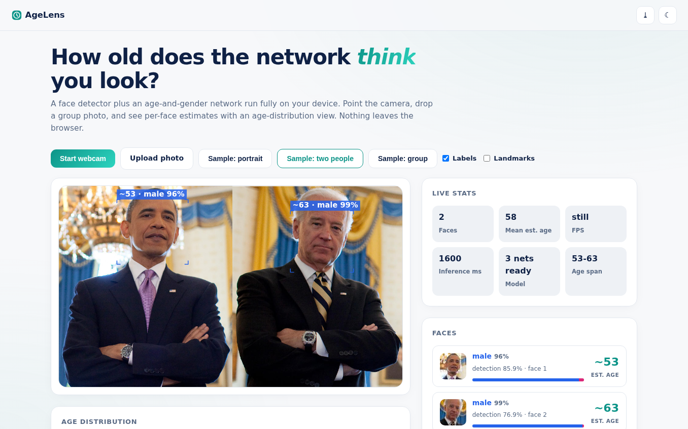
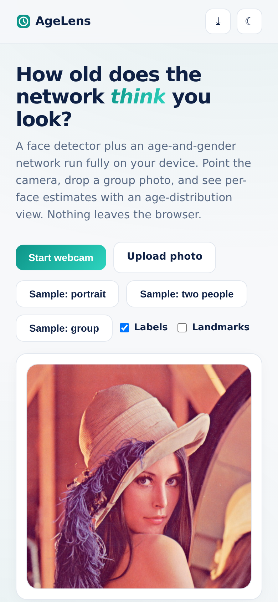

# AgeLens - Age & Gender Estimator

**Neural age and gender estimation for every face in view** - a Tiny-YOLO face detector plus an age/gender network running entirely in your browser. Webcam, uploads, group photos. Nothing is ever uploaded.

**Live demo:** https://akash991833.github.io/age-estimator/

## Features

- **Real in-browser inference** - face-api.js (tiny_face_detector + face_landmark_68 + age_gender), vendored weights, runs on your device
- **Per-face estimates** - estimated age, gender probability bar, detection confidence, cropped thumbnail
- **Age distribution histogram** - group shots bucketed into 7 age ranges
- **Live stats** - faces, mean estimated age, age span, FPS, inference ms
- **Webcam + uploads + samples** - instant sample photos included
- **PWA** - installable; models cache for offline use after first load
- **Premium UI** - white professional design, navy ink, teal accent, dark + light themes, responsive desktop and mobile

## Screenshots

## Honest limits

Age estimation in the wild is approximate - this compact model is typically within about 5-8 years on clear frontal faces and worse on children, side angles, or low light. "Gender" is a binary prediction of presentation (hair, features, styling) from pixels - not identity, and it can be wrong. For demos and fun, never to judge or identify a person. Stated in-app. All inference is local; webcam needs browser permission (HTTPS/localhost).

## Tech

Vanilla HTML/CSS/JS + face-api.js 0.22.2 (vendored). Sample photos: OpenCV samples, ageitgey/face_recognition examples.

## Run locally

Serve the folder (`python3 -m http.server`) and open `http://localhost:8000` (camera needs localhost or HTTPS).
